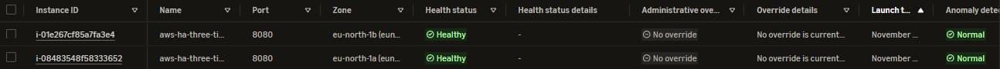
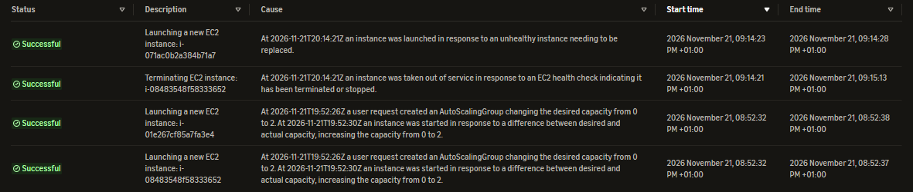
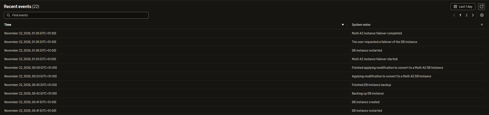

# aws-ha-three-tier

[](https://github.com/zer0nodes/aws-ha-three-tier/actions/workflows/ci.yml)

Highly available three-tier web architecture on AWS, built with Terraform: an Application Load Balancer, an EC2 Auto Scaling Group and RDS PostgreSQL across two Availability Zones.

## Architecture


| Subnets | CIDR | Route out | Contents |
|---|---|---|---|
| `public-a`, `public-b` | 10.10.0.0/24, 10.10.1.0/24 | Internet gateway | ALB nodes, NAT gateway in `public-a` |
| `app-a`, `app-b` | 10.10.10.0/24, 10.10.11.0/24 | NAT gateway | EC2 instances |
| `db-a`, `db-b` | 10.10.20.0/24, 10.10.21.0/24 | None | RDS, with the Multi-AZ standby in the other zone |

| Security group | Inbound | Outbound |
|---|---|---|
| `alb` | 80 from `allowed_cidrs` | 8080 to `app` |
| `app` | 8080 from `alb` | 5432 to `db`; 443 through NAT for SSM, Secrets Manager and packages |
| `db` | 5432 from `app` | None |

Each tier has one subnet per zone. Rules point at security groups, not address ranges: internet → `alb` → `app` → `db`.

## What this demonstrates

- Three tiers in two Availability Zones, with only the load balancer reachable from the internet
- Self-healing: the Auto Scaling group replaces a failed instance by itself
- CPU-based auto scaling with target tracking
- Zero-downtime deployments through instance refresh
- No secrets in code, user data or Terraform state: RDS generates and rotates the password
- No SSH: no key pairs, no port 22, operator access through SSM
- Six measured resilience tests, email alarms and a verified clean teardown

## How it works

1. The ALB forwards HTTP 80 to the instances on port 8080 and checks `GET /health` every 15 s.
2. gunicorn runs a small Flask app. `/api/info` returns the instance, its zone and a visit counter kept in PostgreSQL over TLS, so every instance shows the same count.
3. `/health` skips the database: a database outage turns `/api/info` into quick 503s but replaces no instances.
4. Instances boot Amazon Linux 2023 with IMDSv2, and a `cloud-config` user data installs the app. Changing the code or `app_version` creates a new launch template version, which starts an instance refresh.
5. RDS keeps the master password in Secrets Manager and rotates it every 7 days. The instance role can read only that secret, and the app fetches it again when a rotation breaks the login.
6. A CloudWatch dashboard shows the key metrics, and three alarms (`unhealthy-hosts`, `target-5xx`, `rds-cpu`) notify an SNS topic that emails `alarm_email` when it is set.

## Design decisions & trade-offs

| Decision | Why | Alternative |
|---|---|---|
| One NAT gateway | The biggest fixed cost here | One per zone: no single point of failure for outbound traffic, at double the price |
| HTTP only | HTTPS needs a domain | ACM certificate and a Route 53 domain |
| `/health` skips the database | A database blip must not replace the whole fleet | Deep check: catches more, but cascades on blips |
| App installed at boot | No image pipeline; a code change triggers a refresh | Pre-built AMI: faster boots, needs a build pipeline |
| SSM instead of SSH | No port 22, no keys, audited sessions | Bastion host: more cost and attack surface |
| Password managed by RDS | Never in code or state, rotated automatically | Password variable: ends up in the state |
| Single-AZ RDS by default | Multi-AZ doubles the database cost; `db_multi_az` turns it on | Multi-AZ all the time |
| Scaling on CPU | Simple and easy to drive with a load test | Requests per target: better for I/O-bound apps |
| One flat Terraform module | One environment, a few dozen resources | Nested modules: worth it with several environments |

## Resilience tests

`scripts/probe.py` logged every response during each test. The logs and AWS CLI output are in [`docs/evidence/`](docs/evidence/).

| Test | Action | Result |
|---|---|---|
| [A. Load balancing](docs/evidence/a-load-balancing.txt) | 20 requests to `/api/info` | 10 per instance in two zones, counter without gaps |
| [B. Self-healing](docs/evidence/b-self-healing.txt) | `aws ec2 terminate-instances` on one of two instances | Two healthy targets again after 181 s; 12 errors within 23 s |
| [C. Auto scaling](docs/evidence/c-auto-scaling.txt) | `scripts/load_test.py`: 16 workers for 10 minutes | 2 → 3 instances after 264 s, back to 2 after 15 min 44 s |
| [D. Rolling update](docs/evidence/d-rolling-update.txt) | `terraform apply -var app_version=v2` | 0 errors in 1,200 requests; the refresh took 623 s |
| [E. Network isolation](docs/evidence/e-network-isolation.txt) | AWS CLI checks | No public IPs, RDS not publicly accessible, no route out of the database tier |
| [F. Database failover](docs/evidence/f-rds-failover.txt) | `-var db_multi_az=true`, then `aws rds reboot-db-instance --force-failover` | 15 s of database errors, `/health` 270 of 270 OK, no instance replaced |

- **B:** `terminate-instances` skips deregistration, so the ALB kept routing to the instance until three health checks failed. One later 502 exposed gunicorn's 2 s keep-alive, shorter than the ALB's 60 s idle timeout; it is now 75 s.
- **C:** scale-in waits about 15 minutes on purpose. The 42 client timeouts (0.25%) never reached the ALB; the client opened a new connection for every request.
- **D:** with a minimum of 50% healthy, the refresh replaces one instance at a time, so v1 and v2 answered side by side for about 4 minutes.
- **F:** the Multi-AZ conversion caused 0 errors in 570 requests, and the failover took 34 s by the RDS events.

Screenshots in order: the app, healthy targets in two zones, self-healing, scale-out, instance refresh, dashboard, RDS without public access, RDS failover events.









## Deploy it yourself

Requires AWS CLI 2.32+, Terraform 1.15+, Python 3.13+ and PowerShell 7. Keep the CLI region equal to `aws_region` (default `eu-north-1`). The group can grow to 4 × t3.micro, so the EC2 quota `L-1216C47A` needs at least 8 vCPUs; with less, set `asg_max_size = 2`.

```powershell
aws login
terraform -chdir=infra init
terraform -chdir=infra apply
python scripts/probe.py --url "$(terraform -chdir=infra output -raw app_url)/api/info" --interval 1
```

`apply` takes about 8 minutes, and the app answers 1–2 minutes later. To limit `allowed_cidrs` to your IP or to get alarm emails, copy `infra/terraform.tfvars.example` to `infra/terraform.tfvars` first. After the Multi-AZ conversion, keep `-var db_multi_az=true` on every later `plan` and `apply`. Instances are reachable only through SSM, for example Run Command on the `Project=aws-ha-three-tier` tag. Unit tests: `pip install -r app/requirements.txt pytest==9.2.0`, then `pytest`.

## Cost

On-demand prices in `eu-north-1` from the AWS Price List API (2026-11-22):

| Item | USD per hour |
|---|---|
| NAT gateway and its public IPv4 address | 0.051 |
| Application Load Balancer and its 2 public IPv4 addresses | 0.034 |
| 2 × EC2 t3.micro with 8 GiB gp3 volumes | 0.023 |
| RDS db.t4g.micro Single-AZ with 20 GiB gp3 | 0.019 |
| Secrets Manager secret | 0.001 |
| **Total** | **about 0.13** (about 3.1 USD a day) |

Multi-AZ adds about 0.02 USD/h. The NAT gateway and the ALB bill every started hour, so several `apply` and `destroy` cycles within one hour cost extra.

Actual cost from Cost Explorer, before credits: **1.63 USD** for the whole project (20–22 November 2026, all tests included). More than half of it, 0.89 USD under EC2-Other, was the NAT gateway, which ran in every phase.

## Cleanup

```powershell
terraform -chdir=infra destroy
pwsh -File scripts/verify-clean.ps1
```

`destroy` takes 3–6 minutes. `verify-clean.ps1` checks the whole region for NAT gateways, Elastic IPs, load balancers, RDS and EC2 instances, plus this project's resources by tag or name prefix, and exits with 1 if anything is left. Right after `destroy` it may print notes about an RDS automated snapshot (gone within minutes), an unconfirmed SNS subscription (gone within 48 hours) and the Tagging API, which can list deleted resources for hours.

## Production gaps

HTTPS with ACM and Route 53, a NAT gateway per zone, Multi-AZ RDS with longer backups and deletion protection, application logs in CloudWatch Logs, a pre-built AMI, AWS WAF, remote Terraform state with a least-privilege deployment role.
