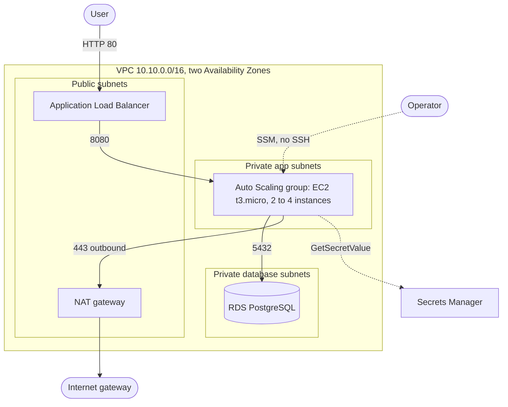
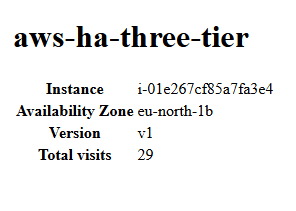
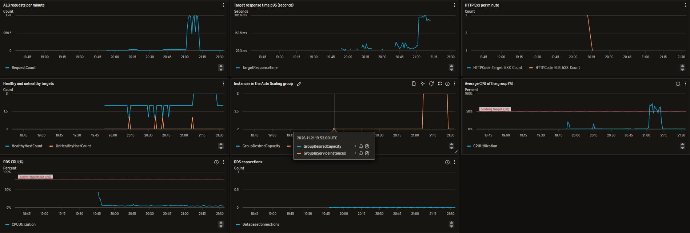
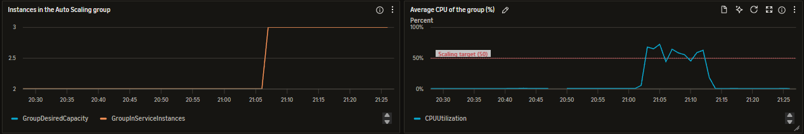
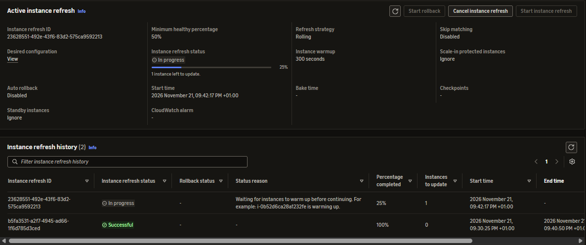
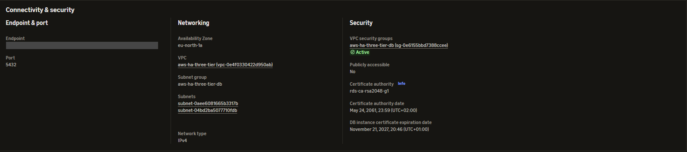

# aws-ha-three-tier


Highly available three-tier web architecture on AWS, built with Terraform: an Application Load Balancer, an EC2 Auto Scaling Group and RDS PostgreSQL across two Availability Zones.

## Architecture



| Subnet | CIDR | Zone | Default route | Contents |
|---|---|---|---|---|
| `public-a` | 10.10.0.0/24 | first | internet gateway | ALB node, NAT gateway |
| `public-b` | 10.10.1.0/24 | second | internet gateway | ALB node |
| `app-a` | 10.10.10.0/24 | first | NAT gateway | EC2 instances |
| `app-b` | 10.10.11.0/24 | second | NAT gateway | EC2 instances |
| `db-a` | 10.10.20.0/24 | first | none | RDS |
| `db-b` | 10.10.21.0/24 | second | none | RDS (the subnet group needs two zones; Multi-AZ puts the standby here) |

The zones are the first two standard zones returned by `aws_availability_zones`, so no zone names are hard-coded and Local Zones are skipped. The third octet encodes the tier: 0–1 public, 10–11 app, 20–21 database.

| Security group | Inbound | Outbound |
|---|---|---|
| `alb` | TCP 80 from `allowed_cidrs` (default `0.0.0.0/0`) | TCP 8080 to `app` |
| `app` | TCP 8080 from `alb` | TCP 443 to `0.0.0.0/0` through the NAT gateway (SSM, Secrets Manager, packages); TCP 5432 to `db` |
| `db` | TCP 5432 from `app` | none |

Rules point at security groups, not at address ranges, so only the tier in front can reach the next one: internet → `alb` → `app` → `db`.

## What this demonstrates

- **Three tiers in two Availability Zones.** Only the load balancer is reachable from the internet. Instances and the database have no public IPs, and the database subnets have no route out of the VPC at all.
- **Self-healing.** The Auto Scaling group uses the load balancer's health check and replaces a killed instance by itself: two healthy targets again 181 s after a termination.
- **Auto scaling on CPU.** Target tracking grows the group under load and shrinks it back afterwards.
- **Zero-downtime deployments.** A new app version rolls out through an instance refresh: 0 errors in 1,200 requests.
- **No secrets anywhere.** RDS generates and rotates the database password in Secrets Manager. It is not in the code, the user data or the Terraform state.
- **No SSH.** No key pairs and no port 22. Operators use SSM Run Command or Session Manager.
- **Measured failures and a clean exit.** Six failure scenarios run against the live stack with numbers below, plus a CloudWatch dashboard, three alarms with e-mail alerts, and a script that confirms nothing billable is left after `terraform destroy`.

## How it works

### Request path

1. The browser calls the load balancer's DNS name on HTTP port 80. The internet-facing ALB has a node in each public subnet.
2. The listener forwards to a target group of instances on port 8080. The target group checks `GET /health` every 15 s; two passes mark a target healthy. A target leaving the group gets 30 s to finish its requests.
3. On each instance, systemd runs gunicorn (2 workers, 4 threads) with a small Flask app as an unprivileged `app` user.
4. `/` and `/api/info` read the instance ID and zone from the instance metadata service (IMDSv2), insert a row into the `visits` table and return the total. Every instance shows the same counter because the state lives in PostgreSQL. The connection uses TLS (`sslmode=require`) and a 3 s connect timeout.
5. `/health` never touches the database. When the database is down, `/api/info` returns a quick 503, but the instances stay healthy and nothing gets replaced.




### Instance bootstrap

- The launch template takes the latest Amazon Linux 2023 AMI from its public SSM parameter. It requires IMDSv2, uses an encrypted gp3 root volume, and has no key pair and no public IP.
- The user data is a `#cloud-config` document rendered by `templatefile`. `write_files` puts `app.py`, `requirements.txt`, the systemd unit and `/etc/app.env` on disk; the files travel base64-encoded with Windows line endings stripped. `runcmd` installs Python 3.15, creates a virtual environment, installs the pinned requirements, adds the `app` system user and starts the service.
- `/etc/app.env` (mode 0600) holds only the database host, port and name, the secret ARN, the region and the app version.
- Changing the app code or `app_version` changes the user data. That creates a new launch template version, and the Auto Scaling group starts an instance refresh on its own.
- The group waits for the NAT route and the database (`depends_on`), so the first instances can download packages and connect on their first boot. New instances get a 300 s grace period before health checks count.

### Database password

- `manage_master_user_password = true` makes RDS generate the master password, store it in Secrets Manager and rotate it every 7 days. The Terraform state only holds the secret's ARN.
- The instance role has `AmazonSSMManagedInstanceCore` and one inline policy: `secretsmanager:GetSecretValue` on that one secret.
- The app reads the secret with boto3 on first use and keeps it in memory. If PostgreSQL rejects the password after a rotation, the app fetches the secret again and retries once. Other connection errors keep the cached credentials.
- Two instances start at the same time and both run `CREATE TABLE IF NOT EXISTS`. The loser of that race gets a duplicate error and retries.

### Monitoring

The CloudWatch dashboard shows ALB requests, p95 response time, 5xx errors, healthy targets, group size, group CPU, and RDS CPU and connections. Three alarms notify an SNS topic, with an e-mail subscription when `alarm_email` is set:

- `unhealthy-hosts`: any unhealthy target for 2 minutes;
- `target-5xx`: at least 5 app errors in 5 minutes;
- `rds-cpu`: RDS CPU above 80% for 10 minutes.



## Design decisions & trade-offs

| Decision | Why | Alternative and its cost |
|---|---|---|
| One NAT gateway | The NAT gateway is the biggest fixed cost here (0.046 USD/h plus its IPv4 address) | One NAT per zone removes the single point of failure for outbound traffic, at double the price. With one NAT, losing its zone cuts the other zone off from packages, SSM and Secrets Manager |
| HTTP only on the ALB | HTTPS needs a domain, and a domain costs real money | ACM certificate and a Route 53 domain: the production setup |
| Shallow health check (`/health` skips the database) | A short database outage must not mark every instance unhealthy and get them all replaced | A deep health check catches more, but turns a database blip into a fleet-wide replacement cascade |
| App installed from user data at boot | No extra tooling, and a code change triggers an instance refresh by itself | A pre-built AMI boots faster without downloading packages, but needs its own build pipeline |
| SSM instead of SSH | No open port 22, no keys to manage, every session audited | A bastion host: one more instance and more attack surface |
| Database password managed by RDS | Never in code, user data or Terraform state; rotated automatically | A password variable ends up in the Terraform state |
| RDS Single-AZ by default | Multi-AZ doubles the database cost, so it is a switch (`db_multi_az`) used for the failover test | Multi-AZ all the time: a highly available data tier |
| Scaling on CPU | The simplest metric, easy to drive with a load test | Requests per target suits I/O-bound apps better |
| One flat Terraform module | One environment and a few dozen resources; nested modules would only hide them | `network`, `compute` and `database` modules pay off with several environments |

Details that matter:

- **Security groups.** Each rule is its own resource, so `alb` and `app` can reference each other without a dependency cycle. Terraform also removes the allow-all egress rule that AWS adds to every new group. The `db` group has no outbound rules: security groups are stateful, so replies still get out.
- **Database settings.** `engine_version = "18"` lets RDS pick and upgrade the minor version without Terraform reporting drift. The lab settings make `destroy` leave nothing billable: 1 day of backups, changes applied immediately, no final snapshot, no deletion protection. Production would use longer retention, a final snapshot and deletion protection.
- **Instance tags.** Default provider tags do not reach instances launched by an Auto Scaling group, so the launch template tags instances and volumes itself. Run Command targets instances by the `Project` tag, and `verify-clean.ps1` uses it to find leftover volumes.
- **First Auto Scaling group in an account.** AWS creates the Auto Scaling service-linked role on the fly, and the first launches can fail until IAM propagates it. `ignore_failed_scaling_activities` lets Terraform wait while the group retries.
- **Detailed monitoring.** One-minute instance metrics let the target tracking alarms use 60 s periods, so scale-out reacts within minutes. The alarms named `TargetTracking-*` belong to Auto Scaling, not to Terraform.
- **Alarm tuning.** `unhealthy-hosts` uses the `Minimum` statistic, so it fires only when every ALB node sees a target as unhealthy, not during a normal instance start. `target-5xx` treats missing data as fine, because the ALB publishes 5xx counts only when they are not zero.
- **gunicorn keep-alive of 75 s.** The default 2 s keep-alive is shorter than the ALB's 60 s idle timeout and caused rare 502 errors generated by the ALB. Test B exposed it. `--no-control-socket` stops gunicorn from creating a control socket in a home directory that the `app` user does not have.
- **Alarm e-mail.** The address lives only in the git-ignored `terraform.tfvars`. The variable is `sensitive`, so it never shows in `plan` or `apply` output.
- **Plan noise on database changes.** Any database change also shows the `read-db-secret` IAM policy as "known after apply". Its policy document is a data source that depends on the database, so Terraform reads it during `apply`, sees no difference and leaves the policy alone. The result is 1 changed resource, not 2.

## Resilience tests

`scripts/probe.py` polled the app during each test and logged the status code, instance, zone, version and visit counter of every response. The full logs and the AWS CLI output are in [`docs/evidence/`](docs/evidence/).

| Test | Action | Result |
|---|---|---|
| [A. Load balancing](docs/evidence/a-load-balancing.txt) | 20 requests to `/api/info` | 20 of 20 OK, 10 from each instance in two zones, visit counter 1 to 20 without gaps |
| [B. Self-healing](docs/evidence/b-self-healing.txt) | `aws ec2 terminate-instances` on one of two instances | Replacement registered after 109 s, **two healthy targets again after 181 s**; 12 failed requests within 23 s of the termination |
| [C. Auto scaling](docs/evidence/c-auto-scaling.txt) | `load_test.py`, 16 workers on `/work?ms=200` for 10 minutes | **Scale-out from 2 to 3 after 264 s**, back to 2 instances 15 min 44 s after the load stopped |
| [D. Rolling update](docs/evidence/d-rolling-update.txt) | `terraform apply -var app_version=v2` | **0 errors in 1,200 requests**; the instance refresh took 623 s |
| [E. Network isolation](docs/evidence/e-network-isolation.txt) | AWS CLI checks | No public IPs, no subnet assigns them, RDS not publicly accessible, no default route for the database tier, rules reference security groups |
| [F. Database failover](docs/evidence/f-rds-failover.txt) | Multi-AZ conversion, then `reboot-db-instance --force-failover` | Conversion with 0 errors in 570 requests; failover cost **15 s of database errors**, `/health` 270 of 270 OK, no instance replaced |

**B. Self-healing.** `terminate-instances` bypasses the Auto Scaling group, so the instance was not deregistered or drained first. The ALB kept routing to it until the health check failed three times at 15 s intervals, which explains the 12 errors. The group noticed the termination after 96 s and launched a replacement. One more 502 came a minute later, outside the failure window, and led to the keep-alive fix above.


**C. Auto scaling.** The policy keeps average CPU at 50%. Scale-out needs three one-minute datapoints above the target. Scale-in waits about 15 minutes of low CPU on purpose, so the group does not flap. The group stopped at 3 instances, not 4, because the new instance was still warming up when the 10 minutes ended. The load generator logged 16,889 requests, a p95 of 432 ms and 42 client-side timeouts (0.25%). Those timeouts never reached the ALB: no 460 errors, and target response time peaked at 0.45 s. The bottleneck was the client, which opens a new TCP connection for every request.



**D. Rolling update.** With a minimum of 50% healthy, the refresh replaces one instance at a time: drain and terminate an old one (30 s), launch a new one, wait out the 300 s warm-up, repeat. For about 4 minutes, v1 and v2 answered side by side. `terraform apply` finished after 10 s, because it does not wait for the refresh.



**E. Network isolation.**



**F. Database failover.** This test is optional, because Multi-AZ doubles the database cost.
- **Conversion to Multi-AZ:** caused no errors and took 5 min 39 s by the RDS events. The standby volume kept loading data in the background for about 13 more minutes.
- **Forced failover:** took 34 s by the RDS events. The endpoint's DNS record, with a 5 s TTL, moved from the `db-b` subnet to `db-a`.
- **What the app saw:** `/api/info` returned 13 fast 503s and one timeout over 15 s. The visit counter continued without a gap.
- **Health checks and alarms:** the ALB kept every target healthy, because `/health` does not depend on the database. The `target-5xx` alarm fired about 3 minutes later, and SNS delivered the e-mail.


## Deploy it yourself

Requirements:

- An AWS account and the AWS CLI v2, signed in with `aws login` or `aws sso login`.
- Terraform 1.15 or newer.
- PowerShell 7 and Python 3.13 or newer. The helper scripts use only the standard library.
- At least 8 vCPUs in the EC2 quota for standard On-Demand instances (`L-1216C47A`), because the group can grow to 4 × t3.micro. With a smaller quota, set `asg_max_size = 2`.

All commands run in PowerShell from the repository root.

1. If you use a named AWS profile, select it for this shell:

    ```powershell
    $env:AWS_PROFILE = "<your-profile>"
    ```

2. Create your variables file. Git ignores it:

    ```powershell
    Copy-Item infra/terraform.tfvars.example infra/terraform.tfvars
    ```

3. Edit `infra/terraform.tfvars`:
    - set `allowed_cidrs` to your own IP as a `/32`;
    - set `alarm_email` if you want e-mail alerts, or remove the line. SNS sends a confirmation link right after `apply`; click it.

4. Deploy. `apply` takes about 8 minutes, most of it for RDS. The app answers 1–2 minutes later, once both targets pass their health checks.

    ```powershell
    terraform -chdir=infra init
    ```

    ```powershell
    terraform -chdir=infra apply
    ```

5. Watch the load balancer spread requests across both instances:

    ```powershell
    python scripts/probe.py --url "$(terraform -chdir=infra output -raw app_url)/api/info" --interval 1
    ```

Repeat the tests:

| Test | Command |
|---|---|
| B | `aws ec2 terminate-instances --instance-ids <one of the two instance IDs>` |
| C | `python scripts/load_test.py --url (terraform -chdir=infra output -raw app_url)` |
| D | `terraform -chdir=infra apply -var app_version=v2` |
| F | `terraform -chdir=infra apply -var db_multi_az=true`, then `aws rds reboot-db-instance --db-instance-identifier (terraform -chdir=infra output -raw db_identifier) --force-failover` |

After the Multi-AZ conversion, keep `-var db_multi_az=true` on every later `plan` and `apply`. Without it, Terraform converts the database back to Single-AZ.

Diagnostics without SSH use Run Command:

```powershell
aws ssm send-command --document-name AWS-RunShellScript --targets "Key=tag:Project,Values=aws-ha-three-tier" --parameters commands="cloud-init status --long; journalctl -u app --no-pager -n 50"
```

```powershell
aws ssm list-command-invocations --details --query "CommandInvocations[].CommandPlugins[].Output"
```

Run the unit tests locally:

```powershell
python -m venv .venv
```

```powershell
.venv\Scripts\python -m pip install -r app/requirements.txt pytest==9.2.0
```

```powershell
.venv\Scripts\python -m pytest
```

## Cost

On-demand prices in `eu-north-1`, checked in the AWS Price List API on 2026-11-22:

| Item | Price | USD per hour |
|---|---|---|
| NAT gateway | 0.046 USD/h, plus 0.046 USD per GB processed | 0.046 |
| 3 public IPv4 addresses (NAT, 2 for the ALB) | 0.005 USD/h each | 0.015 |
| Application Load Balancer | 0.02394 USD/h, plus 0.0076 USD per LCU-hour | 0.024 |
| 2 × EC2 t3.micro | 0.0108 USD/h each | 0.022 |
| 2 × 8 GiB gp3 root volumes | 0.0836 USD per GB-month | 0.002 |
| RDS db.t4g.micro PostgreSQL, Single-AZ | 0.016 USD/h | 0.016 |
| RDS 20 GiB gp3 storage | 0.12 USD per GB-month | 0.003 |
| Secrets Manager secret | 0.40 USD per month | 0.001 |
| **Total** | | **about 0.13** |

Left running, the stack would cost about 3.10 USD a day, or about 94 USD a month.

Extra costs to know about:
- **Multi-AZ** adds about 0.02 USD/h: the instance costs 0.033 USD/h and storage 0.24 USD per GB-month.
- **Detailed monitoring** (7 metrics per instance at 0.30 USD per metric-month) and the 5 alarms (0.10 USD each per month) add fractions of a cent per hour.
- **Billing per started hour:** the NAT gateway and the ALB are billed for every started hour, so several `apply` and `destroy` cycles within one hour each cost a full hour.

## Cleanup

```powershell
terraform -chdir=infra destroy
```

```powershell
./scripts/verify-clean.ps1
```

`destroy` takes 3 to 6 minutes, most of it for RDS. Then `verify-clean.ps1` checks two things:
- **Anything billable in the whole region:** NAT gateways, Elastic IPs, load balancers, RDS instances and EC2 instances.
- **This project's own resources,** by the `Project` tag or the name prefix.

It exits with 0 only when every check is empty. Use `-Region` and `-Project` to check other values.

Right after `destroy`, the script may print three expected notes:
- **RDS automated snapshot:** RDS deletes it a few minutes after the instance.
- **Unconfirmed SNS e-mail subscription:** it cannot be deleted by hand. SNS removes it after 48 hours, at no cost.
- **Entries in the Resource Groups Tagging API:** this API kept listing deleted instances for more than 4 hours. The console's Tag Editor uses the same API, so it cannot confirm a cleanup either.

The `AWSServiceRoleForAutoScaling` role stays in the account. AWS creates it, and it costs nothing.

## Production gaps

- HTTPS with an ACM certificate and a Route 53 domain, with HTTP redirected to HTTPS.
- A NAT gateway per zone, so losing one zone does not cut the other off from the internet.
- Multi-AZ RDS all the time, set in the variables file rather than on the command line, with longer backup retention, a final snapshot and deletion protection.
- Application logs shipped to CloudWatch Logs by the CloudWatch agent; today they stay in the instance journal.
- A pre-built AMI (Packer or EC2 Image Builder) for faster boots that do not depend on package downloads.
- AWS WAF in front of the ALB.
- Remote Terraform state with locking and a least-privilege deployment role.
